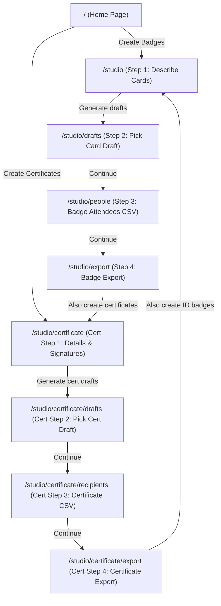

# ACM Content Studio - Comprehensive Architecture & Blueprint

## 1. Project Overview
**ACM Content Studio** is a Next.js (App Router, React 19, Tailwind CSS v4) application built for the **ACM SVNIT Student Chapter**.
It is a unified, automated print-ready production studio for:
- **Event ID Cards & Badges**: CR80 portrait (`54mm × 86mm`) with attendee photos, role color coding, roll numbers, departments, team labels, and attendance QR codes. Multi-card imposition A4/A3 sheets with crop marks.
- **Official Certificates**: A4 Landscape (`297mm × 210mm`) Certificates of Excellence, Merit, Appreciation & Participation. Exact recipient roles, team titles (participants only), dual official authority signatories, and digital verification QR codes.
- **Shared Event Architecture**: Organizers describe an event once; event title, dates, venue, logos, and attendee data seamlessly transfer between ID cards and certificate workflows.
- **AI & Procedural Fallbacks**: Gemini 3.8 Flash via `@google/generative-ai` generates vector SVG specifications (`DesignPlan`), backed by procedural mock fallbacks.

---

## 2. Directory Structure & Key Files

```
acm-content-studio/client/
├── docs/
│   └── design-plan-format.md      # Design plan format specifications
├── public/brand/                  # Official ACM and SVNIT logos
├── scripts/
│   ├── bulk_card_generator.js     # Standalone & CLI batch generator from user templates & CSVs via Sharp
│   └── make-logos.mjs             # Converts logos to base64 data URIs in src/core/brand/logos.ts
├── src/
│   ├── app/
│   │   ├── page.tsx               # Studio Landing page (direct launch for ID Cards & Certificates)
│   │   ├── studio/
│   │   │   ├── layout.tsx         # Studio layout with StudioProvider & dynamic dual Stepper
│   │   │   ├── page.tsx           # Step 1: Describe event (chat intake & missing questions)
│   │   │   ├── drafts/page.tsx    # Step 2: Pick draft, prompt refiner & CardEditor
│   │   │   ├── people/page.tsx    # Step 3: Attendees (CSV & photo upload)
│   │   │   ├── export/page.tsx    # Step 4: Validate design, export panel & cert transition CTA
│   │   │   └── certificate/
│   │   │       ├── page.tsx       # Cert Step 1: Event details, visual theme & dual signatories
│   │   │       ├── drafts/page.tsx # Cert Step 2: Pick A4 certificate draft & natural language refiner
│   │   │       ├── recipients/page.tsx # Cert Step 3: Dedicated certificate CSV upload & attendee import
│   │   │       └── export/page.tsx # Cert Step 4: Multi-page A4 PDF/PNG/SVG export & badge transition
│   │   └── api/
│   │       ├── intake/route.ts    # Extracts event details via Gemini / regex heuristics
│   │       ├── recipes/route.ts   # Generates 3 card design recipes (Gemini or mock fallback)
│   │       │   └── certificate/route.ts # Generates 3 A4 certificate recipes (Gemini or mock fallback)
│   │       ├── refine/route.ts    # Applies prompt instructions to update existing card/cert SVG
│   │       ├── export/route.ts    # Headless Puppeteer server endpoint for multi-page vector PDF
│   │       └── upload/route.ts    # Placeholder endpoint for file upload handlers
│   ├── components/
│   │   ├── Stepper.tsx            # Dual-mode wizard breadcrumb navigation (ID Cards & Certificates)
│   │   ├── CardEditor.tsx         # Interactive canvas editor (drag, scale, align, undo)
│   │   ├── CardPreview.tsx        # DangerouslySetInnerHTML SVG card renderer wrapper with hydrateCard
│   │   ├── CertificateDraftPicker.tsx # 3-column selectable A4 landscape certificate draft gallery
│   │   ├── CsvUpload.tsx          # CSV reader & photo matcher (PapaParse + canvas compression + URL support)
│   │   ├── DraftPicker.tsx        # 3-column selectable draft gallery with attendee hydration
│   │   ├── ExportPanel.tsx        # Multi-format export panel with bulk hydration & certificate cross-promotion
│   │   ├── PersonList.tsx         # Interactive attendee list & active person preview selector
│   │   ├── PromptBox.tsx          # Alternative prompt & event input form
│   │   └── QuestionForm.tsx       # Placeholder TODO for intake question rendering
│   ├── core/
│   │   ├── ai/
│   │   │   ├── certificate.ts     # Dedicated procedural fallback generator for certificates (7 tech themes × 5 layout variants)
│   │   │   ├── gemini.ts          # Google Generative AI integration (models, structured output, cert generator)
│   │   │   ├── intake.ts          # Rule-based interview question engine (missing(), mergeInfo())
│   │   │   ├── mock.ts            # Procedural badge (8 standardized themes) generator for ID cards
│   │   │   └── prompts.ts         # System prompts, JSON schema definitions & design constraints
│   │   ├── brand/
│   │   │   └── logos.ts           # Auto-generated base64 PNG data-URIs for ACM & SVNIT logos
│   │   ├── data/
│   │   │   ├── csv.ts             # CSV parser (parsePeople with team check, parseCertificateRecipients)
│   │   │   └── qr.ts              # QR code matrix calculator for synchronous SVG generation
│   │   ├── engine/
│   │   │   ├── elements.ts        # Element definitions
│   │   │   ├── fit.ts             # Dynamic text shrinkage and truncation calculation
│   │   │   ├── hydrate.ts         # Template placeholder hydration, dynamic font scaling, QR & bulk cert generation
│   │   │   └── render.ts          # Core vector SVG string renderer for badges
│   │   ├── exporter/
│   │   │   ├── pdf.ts             # Client fetch wrapper to /api/export
│   │   │   ├── png.ts             # Canvas rasterizer for 150/300/600 DPI PNG downloads
│   │   │   ├── sheet.ts           # HTML imposition builder for A4/A3 sheets with crop marks & single A4 pages
│   │   │   └── svg.ts             # Client-side blob download utility
│   │   └── validator/
│   │       ├── bounds.ts          # Card boundary & overlap collision detector
│   │       ├── check.ts           # Aggregated validator (bounds + contrast)
│   │       ├── contrast.ts        # WCAG luminance & color contrast validator
│   │       └── schema.ts          # Zod schema definitions for DesignPlan and Element
│   ├── lib/
│   │   ├── constants.ts           # Dimensions (54×86mm, 297×210mm), signatories, sample people/recipients, themes
│   │   └── StudioContext.tsx      # React Context holding global studio state with sessionStorage
│   └── types/
│       └── index.ts               # Core TypeScript definitions (Role, Person, CertificateRecipient, Signatory, EventInfo)
```

---

## 3. Site Map & Studio Workflow



1. **ID Cards Workflow**:
   - **Step 1 (`/studio`)**: Chat intake for event details (`name`, `date`, `venue`, `tagline`, `fields`, `hasPhotos`).
   - **Step 2 (`/studio/drafts`)**: 3 card designs. Edit via natural language (`/api/refine`) or canvas editor.
   - **Step 3 (`/studio/people`)**: Upload attendee CSV and photo batch. Supports `team` for participants.
   - **Step 4 (`/studio/export`)**: Multi-card imposition PDF (A4/A3 with crop marks), PNG, or SVG. Includes call-to-action to create certificates.
2. **Certificate Studio Workflow**:
   - **Step 1 (`/studio/certificate`)**: Configure event title, dates, visual style, and dual authority signatories (Faculty Sponsor & Chapter Chair). Pre-fills from ID card session if available.
   - **Step 2 (`/studio/certificate/drafts`)**: 3 A4 Landscape certificate designs (Classic Honor, Modern Tech, Minimalist Crest). Auto-derives title and citation based on sample recipient roles. Natural language refiner available.
   - **Step 3 (`/studio/certificate/recipients`)**: Dedicated CSV upload for certificate recipients with exact awards/roles. Option to import attendees from ID card list.
   - **Step 4 (`/studio/certificate/export`)**: Batch export to multi-page print-ready vector A4 PDF, PNG (300/600 DPI), or SVG. Includes link to create badges.

---

## 4. Key Implementation Rules & Data Contracts
- **Dimensions**:
  - ID Badges: Standard CR80 badge format: `54mm × 86mm` portrait.
  - Certificates: Standard A4 Landscape: `297mm × 210mm`.
- **Strict Team Visibility Rule**:
  - In both badges and certificates, `team` is strictly displayed **only** for participants and winners.
  - For non-participant roles (`organizer`, `executive`, `volunteer`, `mentor`), `team` is strictly suppressed/empty, even if included in CSV.
- **Exact Certificate Roles & Dynamic Phrasing**:
  - Certificate roles are strictly exact (e.g., `1st Place Winner`, `Runner Up`, `Participant`, `Organizing Lead`).
  - Phrasing is auto-derived via `getCertificatePhrasing(role, eventName, team)`:
    - Winners/Ranks ➔ Heading: **CERTIFICATE**, Subheading: **OF EXCELLENCE** (*"for outstanding performance and securing {role} in {eventName}"*)
    - Organizers/Staff ➔ Heading: **CERTIFICATE**, Subheading: **OF APPRECIATION** (*"in recognition of invaluable dedication as {role} for {eventName}"*)
    - Participants ➔ Heading: **CERTIFICATE**, Subheading: **OF PARTICIPATION** (*"for active and successful participation in {eventName}"*)
  - Placeholders: `{{certificate_heading}}` (large font), `{{certificate_subheading}}` (distinctly smaller font), and legacy `{{certificate_title}}`.
- **Dual Signatories**:
  - Signatory 1: Faculty Sponsor (Name & Title).
  - Signatory 2: Chapter Chairperson (Name & Title).
- **CSV Data Contracts**:
  - **Badge CSV**: Compulsory: `roll_no`, `name`, `department`, `role`. Conditional: `photo` (if hasPhotos). Optional: `team`, `year`.
  - **Certificate CSV**: Compulsory: `name`, `certificate_role` (or `award`/`role`). Optional: `team`, `roll_no`, `department`.
- **State Persistence**: `StudioContext` persists working drafts, badge attendees, and certificate recipients into `sessionStorage` (`studio2`).
- **Known Quirks**:
  - `src/core/engine/elements.ts` and `docs/design-plan-format.md` are empty files.

---

## 5. Project Changelog & Recent Updates
- **[Direct Pre-Feeded Certificate Generation & Minimal Black & White Theme]**: Eliminated Gemini API generation for certificates and added the requested Minimal theme:
  1. *Zero-Latency Direct Serving*: Updated [src/app/api/recipes/certificate/route.ts](file:///e:/Incursion/acm-content-studio/src/app/api/recipes/certificate/route.ts) to directly invoke `makeCertificatePlans(prompt, info)` instead of querying the Gemini API (`generateCertificatePlans`), returning the 5 design variants (*Classic Ivory*, *Editorial White*, *Night Slate*, *Geometric Blue*, *Blueprint*) for the selected event theme instantly (0ms) with zero failure risk.
  2. *Minimal (Black & White) Theme*: Added the 8th theme `minimal` to [src/core/ai/certificate.ts](file:///e:/Incursion/acm-content-studio/src/core/ai/certificate.ts), [src/lib/constants.ts](file:///e:/Incursion/acm-content-studio/src/lib/constants.ts), and [src/app/studio/certificate/page.tsx](file:///e:/Incursion/acm-content-studio/src/app/studio/certificate/page.tsx). Features a clean monochrome palette (crisp `#ffffff` background with rich `#000000` text in Light mode, deep zinc `#09090b` with pure white text in Dark mode) and an ultra-subtle concentric ring watermark.
  3. *Draft Title Display*: Refined [src/components/CertificateDraftPicker.tsx](file:///e:/Incursion/acm-content-studio/src/components/CertificateDraftPicker.tsx) title layout to allow comfortable display of full design variant and theme names.
- **[Certificate Title Hierarchy, Name Sizing & Centered Delegate Signatures]**: Implemented two-line certificate title separation, balanced typography, and centered signatory alignment across certificate layouts:
  1. *Two-Line Certificate Title Hierarchy*: Updated `getCertificatePhrasing` in [src/core/engine/hydrate.ts](file:///e:/Incursion/acm-content-studio/src/core/engine/hydrate.ts) to return `heading` (`"CERTIFICATE"`) and `subheading` (`"OF EXCELLENCE"`, `"OF APPRECIATION"`, or `"OF PARTICIPATION"`). In [src/core/ai/certificate.ts](file:///e:/Incursion/acm-content-studio/src/core/ai/certificate.ts), implemented a two-line visual hierarchy (`{{certificate_heading}}` with `font-size: 44-50px` and `{{certificate_subheading}}` with a distinctly smaller `font-size: 18-20px`). Updated the Gemini certificate prompt in [src/core/ai/gemini.ts](file:///e:/Incursion/acm-content-studio/src/core/ai/gemini.ts) to require both placeholders.
  2. *Refined Recipient Name Font Size*: Tuned down recipient name font sizes from 76-82px down to 50-52px (`data-maxw="850"`) across all 5 design variants in [src/core/ai/certificate.ts](file:///e:/Incursion/acm-content-studio/src/core/ai/certificate.ts) for balanced visual elegance.
  3. *Centered Delegate Signatures*: Ensured delegate signatures and names are strictly horizontally centered over their respective signature lines across all 5 certificate layouts regardless of layout text alignment:
     - In *Editorial White*: Signatory 1 signature (`<image x="169" w="100"/>`) and text are centered at midpoint `x=219` over line `113..325`; Signatory 2 signature (`<image x="452" w="100"/>`) and text are centered at midpoint `x=502` over line `396..608`.
     - In *Blueprint*: Signatory 1 signature (`<image x="146" w="100"/>`) and text are centered at midpoint `x=196` over line `90..302`; Signatory 2 signature (`<image x="426" w="100"/>`) and text are centered at midpoint `x=476` over line `370..582`.
     - In *Classic Ivory*, *Night Slate*, *Geometric Blue*: Left signature (`x="215"`, `w="100"`) is centered at midpoint `x=265` over line `159..371`; Right signature (`x="808"`, `w="100"`) is centered at midpoint `x=858` over line `752..964`.
- **[Theme Standardization Across Badges & Certificates]**: Unified ID card badge themes and fallback decorators in [src/lib/constants.ts](file:///e:/Incursion/acm-content-studio/src/lib/constants.ts) and [src/core/ai/mock.ts](file:///e:/Incursion/acm-content-studio/src/core/ai/mock.ts) to match the official 7 Certificate tech themes (`Default / Academic`, `AI / ML`, `Cybersecurity`, `Web Dev`, `Data Science`, `Cloud / DevOps`, `Open Source`) while preserving the extra `Minimal & clean` theme:
  1. *Unified THEMES Array*: Standardized `THEMES` to the 8 themes with consistent keyword triggers, brand fonts, and vibrant contrast-tested gradients, exporting `interface Theme`.
  2. *Default Theme Alignment*: Set `DEFAULT_THEME = 0` (`Default / Academic` blue and gold corporate aesthetic) as the fallback.
  3. *String-Based Decorator Dispatch*: Refactored `decor(themeId, p)` in [src/core/ai/mock.ts](file:///e:/Incursion/acm-content-studio/src/core/ai/mock.ts) to switch cleanly on `themeId`, implementing dedicated decorators for all 8 themes (including data analytics histogram bars & grid for Data Science, orbital arcs & infra grid for Cloud/DevOps, code skeleton for Web Dev, neural net for AI/ML, neon cuts for Cybersecurity, terminal matrix for Open Source, concentric rings for Minimal, and slanted polygon band for Default / Academic).
  4. *Intake Chips & Greeting Update*: Updated `IDEAS` and `GREETING` in [src/app/studio/page.tsx](file:///e:/Incursion/acm-content-studio/src/app/studio/page.tsx) to provide quick chips matching all 8 themes.
- **[Issue Date Calendar Picker & Display Formatting]**: Updated the Event / Issue Date field in [src/app/studio/certificate/page.tsx](file:///e:/Incursion/acm-content-studio/src/app/studio/certificate/page.tsx) to `<input type="date">` with `[color-scheme:dark]`, giving organizers a native calendar picker modal tailored to the dark interface. Added `formatDisplayDate` in [src/core/engine/hydrate.ts](file:///e:/Incursion/acm-content-studio/src/core/engine/hydrate.ts) converting standard `YYYY-MM-DD` date inputs into prestigious formal certificate date phrasing (e.g. `2026-11-15` ➔ `November 15, 2026`) for print and SVG exports.
- **[Certificate Tech Themes & Authority Signatures Upload]**: Ported the 7 event tech themes and 5 design variants from [Certificate tech themes.html](file:///e:/Incursion/acm-content-studio/Certificate%20tech%20themes.html) into the procedural fallback generator [src/core/ai/certificate.ts](file:///e:/Incursion/acm-content-studio/src/core/ai/certificate.ts), and added official authority signature image uploads:
  1. *7 Event Themes & Subtle Tech Decorators*: Implemented exact Light and Dark palettes, typography, and vector SVG decorators for `AI / ML` (neural network node and connection graph), `Cybersecurity` (matrix binary columns), `Web Dev` (code syntax brackets), `Data Science` (analytics bar chart), `Cloud / DevOps` (vector cloud motif), `Open Source` (git commit graph), and `Default / Academic` (prestigious serif styling).
  2. *5 Distinct Design Variants*: Generated vector A4 landscape SVGs (`viewBox="0 0 1123 794"`) for all 5 archetypes: `Classic Ivory` (traditional academic double-border), `Editorial White` (modern left accent bar), `Night Slate` (dark theme with top/bottom accent bands), `Geometric Blue` (angled corner polygons & diamond dividers), and `Blueprint` (dark technical 40px grid & certified seal badge).
  3. *Authority Signature Upload & SVG Rendering*: Added image file upload controls in [src/app/studio/certificate/page.tsx](file:///e:/Incursion/acm-content-studio/src/app/studio/certificate/page.tsx) with thumbnail preview and canvas optimization for left and right signatories. In [src/core/engine/hydrate.ts](file:///e:/Incursion/acm-content-studio/src/core/engine/hydrate.ts), replaces `{{signature_1}}` and `{{signature_2}}` directly above the signature lines with uploaded signatures or transparent 1×1 PNG fallback.
  4. *Draft Picker Responsive Expansion*: Updated [src/components/CertificateDraftPicker.tsx](file:///e:/Incursion/acm-content-studio/src/components/CertificateDraftPicker.tsx) to render all 5 design variants cleanly in a responsive grid.
- **[Dedicated Certificate Mock Module (`src/core/ai/certificate.ts`)]**: Extracted procedural certificate template generation out of [src/core/ai/mock.ts](file:///e:/Incursion/acm-content-studio/src/core/ai/mock.ts) into a dedicated fallback module [src/core/ai/certificate.ts](file:///e:/Incursion/acm-content-studio/src/core/ai/certificate.ts) exporting `makeCertificatePlans(userPrompt, info)`. Updated [src/core/ai/gemini.ts](file:///e:/Incursion/acm-content-studio/src/core/ai/gemini.ts) to import `makeCertificatePlans` directly from `./certificate`, keeping `src/core/ai/mock.ts` purely dedicated to ID card badge templates and decorators.
- **[Certificate Studio & Cross-Studio Shared Architecture]**: Added comprehensive certificate creation feature integrated with ID cards:
  1. *A4 Landscape Engine & Procedural Templates*: Defined standard A4 Landscape geometry (`297mm × 210mm`). Added `makeCertificatePlans` in [src/core/ai/mock.ts](file:///e:/Incursion/acm-content-studio/src/core/ai/mock.ts) providing 3 print-ready templates: Classic Honor (Navy & Gold ornate border), Modern Tech (Cyber neon framing), and Minimalist Crest (ACM Blue ribbon banner).
  2. *Live Gemini Certificate Generation*: Added `generateCertificatePlans` and updated `refinePlan` in [src/core/ai/gemini.ts](file:///e:/Incursion/acm-content-studio/src/core/ai/gemini.ts) and `/api/recipes/certificate`, prompting Gemini for 297×210mm SVG certificates with dual signatures and verification QR.
  3. *Auto-Derived Phrasing & Exact Roles*: Created `getCertificatePhrasing` in [src/core/engine/hydrate.ts](file:///e:/Incursion/acm-content-studio/src/core/engine/hydrate.ts) dynamically generating Certificate Title (Excellence, Appreciation, Participation), Presentation Text, and Citations based on exact recipient award/role.
  4. *Conditional Team Field*: Added `team` support in [src/types/index.ts](file:///e:/Incursion/acm-content-studio/src/types/index.ts) and [src/core/data/csv.ts](file:///e:/Incursion/acm-content-studio/src/core/data/csv.ts). Enforced strict rule: `team` renders only for participants; strictly suppressed for organizers, executives, volunteers, and mentors.
  5. *Dedicated Certificate CSV Parser*: Implemented `parseCertificateRecipients` in [src/core/data/csv.ts](file:///e:/Incursion/acm-content-studio/src/core/data/csv.ts) with compulsory `name` and exact `certificate_role`.
  6. *Dedicated Certificate Studio Wizard*: Created 4-step wizard at `/studio/certificate` ([page.tsx](file:///e:/Incursion/acm-content-studio/src/app/studio/certificate/page.tsx), [drafts/page.tsx](file:///e:/Incursion/acm-content-studio/src/app/studio/certificate/drafts/page.tsx), [recipients/page.tsx](file:///e:/Incursion/acm-content-studio/src/app/studio/certificate/recipients/page.tsx), [export/page.tsx](file:///e:/Incursion/acm-content-studio/src/app/studio/certificate/export/page.tsx)) and [src/components/CertificateDraftPicker.tsx](file:///e:/Incursion/acm-content-studio/src/components/CertificateDraftPicker.tsx).
  7. *Dual Navigation & Bidirectional Transitions*: Upgraded [src/components/Stepper.tsx](file:///e:/Incursion/acm-content-studio/src/components/Stepper.tsx) to adapt between ID Cards and Certificates, updated [src/app/page.tsx](file:///e:/Incursion/acm-content-studio/src/app/page.tsx) with direct launch cards, and integrated transition banners in both export panels.
  8. *Batch PDF Export*: Updated [src/core/engine/hydrate.ts](file:///e:/Incursion/acm-content-studio/src/core/engine/hydrate.ts) with `hydrateCertificate` and `generateBulkCertificates`, outputting multi-page single-A4 vector PDFs via Puppeteer, high-DPI PNGs, and SVGs.
- **[Card Layout Refinements: Lowered Details, Symmetrical Accent Line & Expanded Vertical Spacing]**: Further refined the procedural ID card badge layouts in [src/core/ai/mock.ts](file:///e:/Incursion/acm-content-studio/src/core/ai/mock.ts):
  1. *Card 1 (Photo-Top) Expanded Vertical Spacing*: Adjusted photo to `y: 27..49` (`22×22mm`, `cy: 38`), giving more vertical room below. Shifted down and expanded vertical gaps between personal details: Name to `y: 56` (7mm clear space below photo), Role badge to `y: 59.8` (text at `y: 63.8`), Roll no. to `y: 69.2` (5.2mm spacing below role), Department to `y: 73.8` (4.6mm spacing below roll no.), balanced centered divider at `x1: 8, x2: 46, y1: 76.2` (equal 8mm margins on left and right), QR code centered below at `x: 23.25, y: 77.2, w: 7.5, h: 7.5`, and Year at `x: 6, y: 81`.
  2. *Card 2 (Side-Bar) Lowered Content*: Maintained `6.5mm` accent rail and shifted all card elements slightly lower for improved spacing (event at `y: 20`, photo at `y: 23.5`, QR at `y: 23.5`, year at `y: 38.5`, roll no. at `y: 55`, name at `y: 61`, role tag at `y: 64.5`, department at `y: 75`, and bottom line at `y: 77.5`).
  3. *Card 3 (Big-Name) Below-Logo Title & Expanded Name-Department Spacing*: Kept title below corner logos at `x: 27, y: 20` (`maxW: 44`, weight `900`). Shifted photo to `y: 24.5..46.5`. Shifted Name down to `y: 53` and Department to `y: 59.5`, expanding the vertical gap between them to 6.5mm. Adjusted Year to `y: 63.8` and QR to `x: 41, y: 55, w: 8, h: 8` above the bottom role banner.
- **[ID Card Logo Size Enlargement]**: Increased the official ACM and SVNIT logo dimensions in [src/core/ai/mock.ts](file:///e:/Incursion/acm-content-studio/src/core/ai/mock.ts) from `8×8mm` to `10×10mm` in Layouts A and C (centered vertically in the header with 5mm margin boundaries) and `9.5×9.5mm` in Layout B, enhancing branding clarity and visual presence across all badge templates.
- **[Card Layouts Refinement: Photo Enlargement, Centered Roll No & Title Sizing]**: Updated [src/core/ai/mock.ts](file:///e:/Incursion/acm-content-studio/src/core/ai/mock.ts) layouts:
  1. *Title Enhancement*: Increased event title font size across all designs to 3.8mm (weight 700) for stronger visual impact.
  2. *Card 1 (Photo-Top)*: Enlarged circular photo to 23×23mm, repositioned roll no. (`id`) into the horizontal center (`x: 27, y: 64.5`), and shifted department, line, and QR code lower to avoid any overlap.
  3. *Card 2 (Side-Bar)*: Moved roll no. (`id`) directly below the photo frame (`x: 5, y: 53.5`), moving name, role tag, and department lower accordingly.
  4. *Card 3 (Big-Name)*: Substantially enlarged circular photo from 16×16mm to 22×22mm with proportionally expanded glow circle, keeping title at 3.8mm with clean spacing.
- **[Participant Name Overflow Fix & Event Name Typography Enhancement]**: Resolved participant names overflowing card boundaries in Design 3 (big-name) and potential overflows in Designs 1 & 2 by tuning base name font sizes down to 4.2mm-4.4mm (weight 700) in [src/core/ai/mock.ts](file:///e:/Incursion/acm-content-studio/src/core/ai/mock.ts). Increased event name size from 2.8mm to 3.4mm with bold weight 700 across all 3 layouts for immediate readability. Upgraded [src/core/engine/hydrate.ts](file:///e:/Incursion/acm-content-studio/src/core/engine/hydrate.ts) with dynamic `fitSvgText` auto-scaling against `data-maxw="44"` margins and updated `fitFont` base sizing to 4.2mm.
- **[Dynamic Role & ID Text Contrast Resolution]**: Resolved critical text invisibility in the Minimal theme (where `#111111` role text was placed on a `#111111` role pill/banner) and low contrast in Horror, Code Editor, and Terminal themes. Implemented WCAG luminance contrast calculator `getContrastInk(hex)` in [src/core/ai/mock.ts](file:///e:/Incursion/acm-content-studio/src/core/ai/mock.ts), computing `p.roleInk` dynamically based on the container fill (`pal.acc`). In layouts A, B, and C, replaced hardcoded `#111111` with `p.roleInk` for `slot: 'role'` and `slot: 'id'`. Strengthened contrast rules in [src/core/ai/gemini.ts](file:///e:/Incursion/acm-content-studio/src/core/ai/gemini.ts) SVG generation prompt.
- **[Describe Page Theme Quick-Chips Updated]**: Updated `IDEAS` in [src/app/studio/page.tsx](file:///e:/Incursion/acm-content-studio/src/app/studio/page.tsx) to focus on tech and corporate themes (`'Terminal & CLI'`, `'Cyberpunk neon'`, `'Code editor'`, `'AI & neural'`, `'Corporate blue'`, `'Minimal & clean'`), providing organizers with one-click intake prompts that directly align with the expanded themes and decorators.
- **[Tech Themes Expansion & Corporate Fallback in Mock Generator]**: Added 4 technical themes to `THEMES` in [src/lib/constants.ts](file:///e:/Incursion/acm-content-studio/src/lib/constants.ts) (Terminal at index 6, Cyberpunk at index 7, Code Editor at index 8, and AI/Neural at index 9) aligning with procedural decorators in [src/core/ai/mock.ts](file:///e:/Incursion/acm-content-studio/src/core/ai/mock.ts). Configured `DEFAULT_THEME = 5` (corporate) in `mock.ts` so that whenever Gemini is unavailable and prompt keywords do not match any theme keywords, the mock generator defaults strictly to the corporate theme badge.
- **[Performance Optimization: Intake Chat Latency & Export Transition Fix]**: Resolved major latency bottlenecks across the workflow:
  1. *Intake Chat Response*: Implemented instant regex heuristic extraction (`extractHeuristicIntake`) in [src/core/ai/intake.ts](file:///e:/Incursion/acm-content-studio/src/core/ai/intake.ts) to detect dates, venues, event names, and card fields in <1ms. Configured `extractIntake` in [src/core/ai/gemini.ts](file:///e:/Incursion/acm-content-studio/src/core/ai/gemini.ts) with `temperature: 0.0` (greedy decoding) and a 2.5-second `Promise.race` timeout fallback, eliminating 10+ second delays when submitting intake prompts. Added active status spinner in [src/app/studio/page.tsx](file:///e:/Incursion/acm-content-studio/src/app/studio/page.tsx). Added 15s timeout to SVG generation (`askSvg`).
  2. *Export Page Transition Freezing*: Eliminated browser main-thread freezes in [src/lib/StudioContext.tsx](file:///e:/Incursion/acm-content-studio/src/lib/StudioContext.tsx) by stripping heavy base64 `data:image` attendee photo strings before serializing to `sessionStorage` (preventing quota exceptions and CPU-heavy double stringification of megabytes of image data), and debounced `sessionStorage` writes by 300ms. In [src/app/studio/people/page.tsx](file:///e:/Incursion/acm-content-studio/src/app/studio/people/page.tsx), added automatic prefetching (`router.prefetch('/studio/export')`) on mount and hover, and added visual button loading feedback (`Loading Export Studio…`) during route transition.
- **[Refine Prompt Enhancement, SVG Change Verification & Target Index Safety]**: Upgraded `refinePlan` in [src/core/ai/gemini.ts](file:///e:/Incursion/acm-content-studio/src/core/ai/gemini.ts) with assertive graphic designer rules to boldly apply user-requested visual modifications, preserve exact `{{placeholder}}` slots and brand logos (`/brand/acm_logo.png`, `/brand/svnit_logo.jpg`), and maintain CR80 badge geometry (`54mm × 86mm`). Added server logging in `refinePlan` and [src/app/api/refine/route.ts](file:///e:/Incursion/acm-content-studio/src/app/api/refine/route.ts) to verify whether Gemini returned modified SVG content (`Did SVG change: true/false`). Fixed closure draft index in [src/lib/StudioContext.tsx](file:///e:/Incursion/acm-content-studio/src/lib/StudioContext.tsx) (`targetIndex = sel`) to ensure the exact draft being edited updates cleanly upon asynchronous refinement.
- **[Fix /api/refine Plan Validation for SVG-First Badges]**: Updated [src/app/api/refine/route.ts](file:///e:/Incursion/acm-content-studio/src/app/api/refine/route.ts) to recognize and process SVG-based `DesignPlan` objects (`typeof plan === 'object' && plan.svg`) directly through `refinePlan`, resolving the `"Invalid plan format."` error caused by the legacy element-based `planSchema.safeParse` failing on modern SVG badges with `elements: []`.
- **[Compulsory CSV Columns & Missing Photo Reporting]**: Updated [src/core/data/csv.ts](file:///e:/Incursion/acm-content-studio/client/src/core/data/csv.ts), [src/components/CsvUpload.tsx](file:///e:/Incursion/acm-content-studio/client/src/components/CsvUpload.tsx), and [scripts/bulk_card_generator.js](file:///e:/Incursion/acm-content-studio/client/scripts/bulk_card_generator.js) to enforce `roll_no`, `name`, `department`, and `role` as baseline compulsory columns. The `photo` column is strictly enforced as compulsory whenever cards contain photos (`hasPhotos` or `{{photo}}`). Added support for local file names and external HTTP/HTTPS URLs. If any attendee photo is missing, unreadable, or inaccessible, the engine automatically embeds the default photo (`/people/img_3.jpg`) and reports the specific roll numbers and names of all affected attendees in both the UI and CLI generator logs.
- **[User-Template Bulk Card Generation & Studio Export Integration]**: Refactored [scripts/bulk_card_generator.js](file:///e:/Incursion/acm-content-studio/client/scripts/bulk_card_generator.js) to eliminate MongoDB and hardcoded asset requirements, transforming it into a clean, standalone function and CLI utility that hydrates user-provided SVG draft templates with user-provided CSV rows and local/URL images via Sharp. Created [src/core/engine/hydrate.ts](file:///e:/Incursion/acm-content-studio/client/src/core/engine/hydrate.ts) providing `hydrateCard` and `generateBulkCards` with dynamic font scaling (`fitFont`), XML escaping, photo insertion, and data URI QR code generation (`{{qr}}`). Upgraded [src/components/ExportPanel.tsx](file:///e:/Incursion/acm-content-studio/client/src/components/ExportPanel.tsx) to execute bulk hydration across all CSV attendees on export (supporting PDF single/sheets with crop marks, PNG at 150/300/600 DPI, and SVG vector downloads). Connected [src/components/PersonList.tsx](file:///e:/Incursion/acm-content-studio/client/src/components/PersonList.tsx) to render and select loaded attendees on Step 3, and updated [src/components/CardPreview.tsx](file:///e:/Incursion/acm-content-studio/client/src/components/CardPreview.tsx) and [src/components/DraftPicker.tsx](file:///e:/Incursion/acm-content-studio/client/src/components/DraftPicker.tsx) to preview real attendee data.
- **[Role Expansion: Executive Added]**: Added `'executive'` role to `Role` type in `src/types/index.ts`, added its accent color (`#f59e0b`) in `ROLE_COLORS` in `src/lib/constants.ts`, and included it in the CSV validator `ROLES` list in `src/core/data/csv.ts`.
- **[Conditional Photo Question & Custom Preview Photo Upload]**: Linked `info.hasPhotos` directly to whether `'photo'` is selected in `info.fields` (`info.hasPhotos = Boolean(info.fields?.includes('photo'))`). If photo is selected, the intake asks a follow-up question: *"Will you upload photos for the people?"*. If the user answers No, the badge uses the default preview photo (`/people/img_3.jpg`). If the user answers Yes, the intake renders a dedicated `.jpg`/`.jpeg` file upload area. Upon uploading, the image is converted to an optimized data URI via canvas, registered in `StudioContext` via `setPreviewPhoto(dataUrl)`, and immediately updates the preview card photo across `DraftPicker`, `CardEditor`, and `CardPreview`. Updated `src/core/ai/mock.ts` to output dynamic `{{photo}}` placeholders and `src/components/CardEditor.tsx` to recognize `data:image` URLs as editable photos.
- **[Default Profile Picture Integration (`/people/img_3.jpg`)]**: Wired `public/people/img_3.jpg` as the default profile picture for draft previewing and editing. Updated `SAMPLE_PEOPLE` in [src/lib/constants.ts](file:///e:/Incursion/acm-content-studio/client/src/lib/constants.ts) to provide `/people/img_3.jpg` as the default photo for sample attendees. Updated default mock draft SVG generation in [src/core/ai/mock.ts](file:///e:/Incursion/acm-content-studio/client/src/core/ai/mock.ts) to link `/people/img_3.jpg` in photo frames. Expanded photo URL validation in [src/core/engine/render.ts](file:///e:/Incursion/acm-content-studio/client/src/core/engine/render.ts) to accept public paths and external URLs in addition to base64 URIs. Configured [src/components/CardEditor.tsx](file:///e:/Incursion/acm-content-studio/client/src/components/CardEditor.tsx), [src/components/DraftPicker.tsx](file:///e:/Incursion/acm-content-studio/client/src/components/DraftPicker.tsx), and [src/components/CardPreview.tsx](file:///e:/Incursion/acm-content-studio/client/src/components/CardPreview.tsx) to hydrate raw `{{photo}}` placeholders with `person?.photo || '/people/img_3.jpg'` during preview rendering, with drag/scale controls recognizing `/people/` image paths.
- **[Theme-Based Mock SVG Fallbacks & Hardcoded Template Clean-up]**: Refactored [src/core/ai/mock.ts](file:///e:/Incursion/acm-content-studio/client/src/core/ai/mock.ts) to compile its 6 keyword themes (horror, retro, minimal, nature, festive, corporate) and 3 layout archetypes directly into raw, print-ready SVG drafts with official ACM/SVNIT logos, dynamic placeholders, and photo clipping frames. Completely removed the hardcoded static `DEFAULT_SVG_TEMPLATES` from [src/core/ai/gemini.ts](file:///e:/Incursion/acm-content-studio/client/src/core/ai/gemini.ts) and wired `makePlans(userPrompt, info)` from `mock.ts` as the dynamic fallback whenever Gemini generation is unavailable or needs additional drafts.
- **[Live Gemini 3.8 Flash Integration & Dynamic User Input Mapping]**: Updated `.env.local` and [src/core/ai/gemini.ts](file:///e:/Incursion/acm-content-studio/client/src/core/ai/gemini.ts) default model to `gemini-3.8-flash` (resolving the Google API 404 on legacy `gemini-2.5-flash`). Refined `generatePlans` to dynamically map the user's event inputs (`info.name`, `prompt`/theme, `info.date`, `info.venue`, `info.tagline`, `info.hasPhotos`, and active `info.fields`) into 3 distinct style variations (Dark Immersive, Clean Minimalist, and Bold Graphic). Integrated server logging for live SVG generation progress and plan counts.
- **[SVG-Native CardEditor Type Safety & Mask Synchronization]**: Refactored [src/components/CardEditor.tsx](file:///e:/Incursion/acm-content-studio/client/src/components/CardEditor.tsx) to ensure 100% type safety with `DesignPlan` state updates via `updatePlanWithSvg`. Implemented synchronized clip-path movement and scaling so masked elements (like attendee photos with circle or rect `clip-path`) maintain alignment with their clipping boundaries when dragged, resized, or aligned. Added `onPointerCancel` and `onLostPointerCapture` handlers to ensure reliable gesture handling.
- **[Public Brand Logos Integration (ACM & SVNIT)]**: Configured the SVG prompt and fallback templates in `src/core/ai/gemini.ts` to include both official brand assets from `public/brand/` (`/brand/acm_logo.png` and `/brand/svnit_logo.jpg`), ensuring both square logos appear cleanly without overlap and render directly in the browser SVG draft previews.
- **[Raw SVG Generation & Dynamic Field Placeholders]**: Upgraded `src/core/ai/gemini.ts` to generate single, self-contained raw SVG badges directly using the CairoSVG-compatible SVG prompt template (54×86mm portrait, clipPaths, Arial/Helvetica fonts, and prominent `__LOGO__` diamond placement). Placeholders are generated dynamically from active user-selected fields (`info.fields`, including `{{name}}`, `{{position}}`, `{{roll_no}}`, `{{department}}`, `{{year}}`, `{{photo}}`, `{{qr}}`). Drafts are generated in parallel with 3 style variations and default fallback templates, integrated into `DraftPicker`, `CardPreview`, and `CardEditor` without requiring a hydration layer.
- **[Inlined Prompt Construction in Gemini Service]**: Embedded prompt creation logic directly inside local `prompt` variables within `src/core/ai/gemini.ts` (`generatePlans`, `refinePlan`, and `extractIntake`), eliminating the dependency on `src/core/ai/prompts.ts`. The `generatePlans` function compiles event details, slots, design rules, and styles into a unified prompt variable, validating outputs and returning 3 preview drafts with automated fallback to default mock templates.
- **[Centralized Gemini Fallback, Recipes Route Delegation & Structured Logging]**: Refactored `generatePlans` in `src/core/ai/gemini.ts` to directly handle falling back to default mock templates (`makePlans`) with detailed server console warnings when Gemini fails or returns 0 valid designs. Simplified `POST /api/recipes` (`src/app/api/recipes/route.ts`) to call `generatePlans` directly, adding structured server console logs for request intake, generation status, plan counts, and fallback notices.
- **[API Generation Cycle with Default Templates]**: Configured the end-to-end draft creation cycle. Clicking "Generate drafts" sends `{ prompt, info }` to `POST /api/recipes`, which returns the 3 default draft plans (`makePlans`), populates `StudioContext`, and navigates to the `/studio/drafts` page with loading feedback on the button.
- **[Workflow Reordering: Steps 2 & 3 Swapped]**: Reordered the studio flow so clicking "Generate drafts" navigates directly to `/studio/drafts` (Step 2), followed by `/studio/people` (Step 3), and finally `/studio/export` (Step 4). Updated Stepper labels, router navigation buttons, and step indicators.
- **[Documentation & Ground Rules Initialized]**: Established strict agent operating rules, comprehensive architecture blueprint, directory mapping, and workflow specification.

