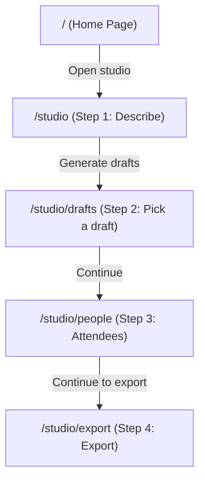

# ACM Content Studio - Comprehensive Architecture & Blueprint

## 1. Project Overview
**ACM Content Studio** is a Next.js (App Router, React 19, Tailwind CSS v4) application built for the **ACM SVNIT Student Chapter**.
It is an automated event badge and ID card creation studio:
- Organizers describe events in natural language or choose preset themes.
- AI (Gemini 2.5 Flash via `@google/generative-ai` with structured JSON output, backed by procedural mock fallbacks) generates vector-based design specifications (`DesignPlan`).
- Organizers upload participant CSVs and photo batches (matched by roll number), with automatic QR code generation.
- Organizers can preview, refine with text prompts, or interactively tweak cards on a live drag-and-drop canvas.
- Badges export to vector SVG, high-DPI PNGs (150/300/600), or print-ready multi-card PDF sheets (A4/A3 with crop marks via Puppeteer).

---

## 2. Directory Structure & Key Files

```
acm-content-studio/client/
├── docs/
│   └── design-plan-format.md      # Design plan format specifications
├── public/brand/                  # Official ACM and SVNIT logos
├── scripts/
│   ├── bulk_card_generator.js     # Standalone & CLI batch generator from user templates & CSVs via Sharp (no DB dependency)
│   └── make-logos.mjs             # Converts logos to base64 data URIs in src/core/brand/logos.ts
├── src/
│   ├── app/
│   │   ├── page.tsx               # Landing page
│   │   ├── studio/
│   │   │   ├── layout.tsx         # Studio layout with StudioProvider & Stepper
│   │   │   ├── page.tsx           # Step 1: Describe event (chat intake & missing questions)
│   │   │   ├── drafts/page.tsx    # Step 2: Pick draft, prompt refiner & CardEditor
│   │   │   ├── people/page.tsx    # Step 3: Attendees (CSV & photo upload)
│   │   │   └── export/page.tsx    # Step 4: Validate design & export panel
│   │   └── api/
│   │       ├── intake/route.ts    # Extracts event details via Gemini / regex heuristics
│   │       ├── recipes/route.ts   # Generates 3 card design recipes (Gemini or mock fallback)
│   │       ├── refine/route.ts    # Applies prompt instructions to update an existing plan
│   │       ├── export/route.ts    # Headless Puppeteer server endpoint for multi-page vector PDF
│   │       └── upload/route.ts    # Placeholder endpoint for file upload handlers
│   ├── components/
│   │   ├── Stepper.tsx            # 4-stage wizard breadcrumb navigation
│   │   ├── CardEditor.tsx         # Interactive canvas editor (drag, scale, align, undo)
│   │   ├── CardPreview.tsx        # DangerouslySetInnerHTML SVG card renderer wrapper with hydrateCard
│   │   ├── CsvUpload.tsx          # CSV reader & photo matcher (PapaParse + canvas compression + URL support)
│   │   ├── DraftPicker.tsx        # 3-column selectable draft gallery with attendee hydration
│   │   ├── ExportPanel.tsx        # Multi-format export panel (PDF sheets/single, 150/300/600 DPI PNG, SVG) with bulk hydration
│   │   ├── PersonList.tsx         # Interactive attendee list & active person preview selector
│   │   ├── PromptBox.tsx          # Alternative prompt & event input form
│   │   └── QuestionForm.tsx       # Placeholder TODO for intake question rendering
│   ├── core/
│   │   ├── ai/
│   │   │   ├── gemini.ts          # Google Generative AI integration (models, structured output)
│   │   │   ├── intake.ts          # Rule-based interview question engine (missing(), mergeInfo())
│   │   │   ├── mock.ts            # Thematic procedural SVG badge generator (6 themes × 3 layouts, fallback for Gemini)
│   │   │   └── prompts.ts         # System prompts, JSON schema definitions & design constraints
│   │   ├── brand/
│   │   │   └── logos.ts           # Auto-generated base64 PNG data-URIs for ACM & SVNIT logos
│   │   ├── data/
│   │   │   ├── csv.ts             # CSV parser, column alias normalizer, data validator
│   │   │   └── qr.ts              # QR code matrix calculator for synchronous SVG generation
│   │   ├── engine/
│   │   │   ├── elements.ts        # Element definitions
│   │   │   ├── fit.ts             # Dynamic text shrinkage and truncation calculation
│   │   │   ├── hydrate.ts         # Template placeholder hydration, dynamic font scaling, QR & bulk card generation
│   │   │   └── render.ts          # Core vector SVG string renderer for badges
│   │   ├── exporter/
│   │   │   ├── pdf.ts             # Client fetch wrapper to /api/export
│   │   │   ├── png.ts             # Canvas rasterizer for 150/300/600 DPI PNG downloads
│   │   │   ├── sheet.ts           # HTML imposition builder for A4/A3 sheets with crop marks
│   │   │   └── svg.ts             # Client-side blob download utility
│   │   └── validator/
│   │       ├── bounds.ts          # Card boundary & overlap collision detector
│   │       ├── check.ts           # Aggregated validator (bounds + contrast)
│   │       ├── contrast.ts        # WCAG luminance & color contrast validator
│   │       └── schema.ts          # Zod schema definitions for DesignPlan and Element
│   ├── lib/
│   │   ├── constants.ts           # Dimensions (54×86mm), role colors, sample people, themes
│   │   └── StudioContext.tsx      # React Context holding global studio state with sessionStorage
│   └── types/
│       └── index.ts               # Core TypeScript definitions (Role, Person, EventInfo, Element, DesignPlan)
```

---

## 3. Site Map & Studio Workflow



1. **Step 1 (`/studio`)**: User interacts with chat intake. Questions fill missing info (`name`, `date`, `venue`, `tagline`, `fields`, `hasPhotos`). Triggers `/api/recipes`.
2. **Step 2 (`/studio/drafts`)**: Visualizes 3 generated design plans. User can edit with natural language (`/api/refine`) or directly drag/scale/realign on the card canvas (`CardEditor`).
3. **Step 3 (`/studio/people`)**: Organizers upload CSV with attendee details and photo files named by roll number. Falls back to `SAMPLE_PEOPLE`.
4. **Step 4 (`/studio/export`)**: Validates card bounds and WCAG contrast. Exports single cards or batches to PDF (A4/A3 sheets with crop marks via Puppeteer), PNG, or SVG.

---

## 4. Key Implementation Rules & Data Contracts
- **Card Size**: Standard CR80 badge format: `54mm × 86mm`. All coordinates in millimeters with origin at top-left.
- **Strict Data Integrity**: Badge engine never invents names, numbers, or details. Text comes exclusively from data slots.
- **CSV Data Contract**:
  - Compulsory columns: `roll_no`, `name`, `department`, `role`.
  - Conditional compulsory: `photo` column is compulsory if cards contain photos (`hasPhotos: true` or template uses `{{photo}}`).
  - Optional columns: `year` and any additional columns.
  - Photo values: May contain a local file name (matched against uploaded photos/folder), external URL (`http://`/`https://`), or data URI. If missing, not found, or inaccessible, the engine automatically embeds the default photo (`/people/img_3.jpg`) and logs/displays the affected attendee roll numbers.
- **State Persistence**: `StudioContext` persists working drafts and attendee lists into `sessionStorage` (`studio2`).
- **Known Quirks**:
  - `src/core/engine/elements.ts` and `docs/design-plan-format.md` are empty files.

---

## 5. Project Changelog & Recent Updates
- **[Intake Markdown Label Parser & SVG Generation Timeout Fix]**: Fixed site failures when pasting structured multi-line event descriptions:
  1. *Markdown Intake Extraction*: Upgraded `extractHeuristicIntake` in [src/core/ai/intake.ts](file:///e:/Incursion/acm-content-studio/src/core/ai/intake.ts) to instantly (<1ms) parse formatted markdown prompts (`**Event Title:**`, `**Theme:**`, `**Date:**`, `**Venue:**`). Added regex support for `Month Day, Year` dates (e.g., `November 15, 2026`) and multi-segment venues (e.g., `Main Auditorium, ABC Institute of Technology, Ahmedabad`), stripping markdown asterisks (`**`) cleanly and eliminating redundant missing-info questions in the studio chat.
  2. *Gemini SVG Generation Timeout*: Increased `askSvg` timeout in [src/core/ai/gemini.ts](file:///e:/Incursion/acm-content-studio/src/core/ai/gemini.ts) from 15s to 45s, allowing Gemini adequate time to generate complete, high-detail vector SVGs (~30-35s) without aborting to mock fallback templates. Increased `askJsonWithTimeout` from 2.5s to 7s.
  3. *Model Configuration*: Set default fallback model to `gemini-3.5-flash` in [src/core/ai/gemini.ts](file:///e:/Incursion/acm-content-studio/src/core/ai/gemini.ts) and [.env.local](file:///e:/Incursion/acm-content-studio/.env.local), replacing the deprecated/lagging model names.
- **[Performance Optimization: Intake Chat Latency & Export Transition Fix]**: Resolved major latency bottlenecks across the workflow:
  1. *Intake Chat Response*: Implemented instant regex heuristic extraction (`extractHeuristicIntake`) in [src/core/ai/intake.ts](file:///e:/Incursion/acm-content-studio/src/core/ai/intake.ts) to detect dates, venues, event names, and card fields in <1ms. Configured `extractIntake` in [src/core/ai/gemini.ts](file:///e:/Incursion/acm-content-studio/src/core/ai/gemini.ts) with `temperature: 0.0` (greedy decoding) and a 2.5-second `Promise.race` timeout fallback, eliminating 10+ second delays when submitting intake prompts. Added active status spinner in [src/app/studio/page.tsx](file:///e:/Incursion/acm-content-studio/src/app/studio/page.tsx). Added 15s timeout to SVG generation (`askSvg`).
  2. *Export Page Transition Freezing*: Eliminated browser main-thread freezes in [src/lib/StudioContext.tsx](file:///e:/Incursion/acm-content-studio/src/lib/StudioContext.tsx) by stripping heavy base64 `data:image` attendee photo strings before serializing to `sessionStorage` (preventing quota exceptions and CPU-heavy double stringification of megabytes of image data), and debounced `sessionStorage` writes by 300ms. In [src/app/studio/people/page.tsx](file:///e:/Incursion/acm-content-studio/src/app/studio/people/page.tsx), added automatic prefetching (`router.prefetch('/studio/export')`) on mount and hover, and added visual button loading feedback (`Loading Export Studio…`) during route transition.
- **[Refine Prompt Enhancement, SVG Change Verification & Target Index Safety]**: Upgraded `refinePlan` in [src/core/ai/gemini.ts](file:///e:/Incursion/acm-content-studio/src/core/ai/gemini.ts) with assertive graphic designer rules to boldly apply user-requested visual modifications, preserve exact `{{placeholder}}` slots and brand logos (`/brand/acm_logo.png`, `/brand/svnit_logo.jpg`), and maintain CR80 badge geometry (`54mm × 86mm`). Added server logging in `refinePlan` and [src/app/api/refine/route.ts](file:///e:/Incursion/acm-content-studio/src/app/api/refine/route.ts) to verify whether Gemini returned modified SVG content (`Did SVG change: true/false`). Fixed closure draft index in [src/lib/StudioContext.tsx](file:///e:/Incursion/acm-content-studio/src/lib/StudioContext.tsx) (`targetIndex = sel`) to ensure the exact draft being edited updates cleanly upon asynchronous refinement.
- **[Fix /api/refine Plan Validation for SVG-First Badges]**: Updated [src/app/api/refine/route.ts](file:///e:/Incursion/acm-content-studio/src/app/api/refine/route.ts) to recognize and process SVG-based `DesignPlan` objects (`typeof plan === 'object' && plan.svg`) directly through `refinePlan`, resolving the `"Invalid plan format."` error caused by the legacy element-based `planSchema.safeParse` failing on modern SVG badges with `elements: []`.
- **[Compulsory CSV Columns & Missing Photo Reporting]**: Updated [src/core/data/csv.ts](file:///e:/Incursion/acm-content-studio/client/src/core/data/csv.ts), [src/components/CsvUpload.tsx](file:///e:/Incursion/acm-content-studio/client/src/components/CsvUpload.tsx), and [scripts/bulk_card_generator.js](file:///e:/Incursion/acm-content-studio/client/scripts/bulk_card_generator.js) to enforce `roll_no`, `name`, `department`, and `role` as baseline compulsory columns. The `photo` column is strictly enforced as compulsory whenever cards contain photos (`hasPhotos` or `{{photo}}`). Added support for local file names and external HTTP/HTTPS URLs. If any attendee photo is missing, unreadable, or inaccessible, the engine automatically embeds the default photo (`/people/img_3.jpg`) and reports the specific roll numbers and names of all affected attendees in both the UI and CLI generator logs.
- **[User-Template Bulk Card Generation & Studio Export Integration]**: Refactored [scripts/bulk_card_generator.js](file:///e:/Incursion/acm-content-studio/client/scripts/bulk_card_generator.js) to eliminate MongoDB and hardcoded asset requirements, transforming it into a clean, standalone function and CLI utility that hydrates user-provided SVG draft templates with user-provided CSV rows and local/URL images via Sharp. Created [src/core/engine/hydrate.ts](file:///e:/Incursion/acm-content-studio/client/src/core/engine/hydrate.ts) providing `hydrateCard` and `generateBulkCards` with dynamic font scaling (`fitFont`), XML escaping, photo insertion, and data URI QR code generation (`{{qr}}`). Upgraded [src/components/ExportPanel.tsx](file:///e:/Incursion/acm-content-studio/client/src/components/ExportPanel.tsx) to execute bulk hydration across all CSV attendees on export (supporting PDF single/sheets with crop marks, PNG at 150/300/600 DPI, and SVG vector downloads). Connected [src/components/PersonList.tsx](file:///e:/Incursion/acm-content-studio/client/src/components/PersonList.tsx) to render and select loaded attendees on Step 3, and updated [src/components/CardPreview.tsx](file:///e:/Incursion/acm-content-studio/client/src/components/CardPreview.tsx) and [src/components/DraftPicker.tsx](file:///e:/Incursion/acm-content-studio/client/src/components/DraftPicker.tsx) to preview real attendee data.
- **[Role Expansion: Executive Added]**: Added `'executive'` role to `Role` type in `src/types/index.ts`, added its accent color (`#f59e0b`) in `ROLE_COLORS` in `src/lib/constants.ts`, and included it in the CSV validator `ROLES` list in `src/core/data/csv.ts`.
- **[Conditional Photo Question & Custom Preview Photo Upload]**: Linked `info.hasPhotos` directly to whether `'photo'` is selected in `info.fields` (`info.hasPhotos = Boolean(info.fields?.includes('photo'))`). If photo is selected, the intake asks a follow-up question: *"Will you upload photos for the people?"*. If the user answers No, the badge uses the default preview photo (`/people/img_3.jpg`). If the user answers Yes, the intake renders a dedicated `.jpg`/`.jpeg` file upload area. Upon uploading, the image is converted to an optimized data URI via canvas, registered in `StudioContext` via `setPreviewPhoto(dataUrl)`, and immediately updates the preview card photo across `DraftPicker`, `CardEditor`, and `CardPreview`. Updated `src/core/ai/mock.ts` to output dynamic `{{photo}}` placeholders and `src/components/CardEditor.tsx` to recognize `data:image` URLs as editable photos.
- **[Default Profile Picture Integration (`/people/img_3.jpg`)]**: Wired `public/people/img_3.jpg` as the default profile picture for draft previewing and editing. Updated `SAMPLE_PEOPLE` in [src/lib/constants.ts](file:///e:/Incursion/acm-content-studio/client/src/lib/constants.ts) to provide `/people/img_3.jpg` as the default photo for sample attendees. Updated default mock draft SVG generation in [src/core/ai/mock.ts](file:///e:/Incursion/acm-content-studio/client/src/core/ai/mock.ts) to link `/people/img_3.jpg` in photo frames. Expanded photo URL validation in [src/core/engine/render.ts](file:///e:/Incursion/acm-content-studio/client/src/core/engine/render.ts) to accept public paths and external URLs in addition to base64 URIs. Configured [src/components/CardEditor.tsx](file:///e:/Incursion/acm-content-studio/client/src/components/CardEditor.tsx), [src/components/DraftPicker.tsx](file:///e:/Incursion/acm-content-studio/client/src/components/DraftPicker.tsx), and [src/components/CardPreview.tsx](file:///e:/Incursion/acm-content-studio/client/src/components/CardPreview.tsx) to hydrate raw `{{photo}}` placeholders with `person?.photo || '/people/img_3.jpg'` during preview rendering, with drag/scale controls recognizing `/people/` image paths.
- **[Theme-Based Mock SVG Fallbacks & Hardcoded Template Clean-up]**: Refactored [src/core/ai/mock.ts](file:///e:/Incursion/acm-content-studio/client/src/core/ai/mock.ts) to compile its 6 keyword themes (horror, retro, minimal, nature, festive, corporate) and 3 layout archetypes directly into raw, print-ready SVG drafts with official ACM/SVNIT logos, dynamic placeholders, and photo clipping frames. Completely removed the hardcoded static `DEFAULT_SVG_TEMPLATES` from [src/core/ai/gemini.ts](file:///e:/Incursion/acm-content-studio/client/src/core/ai/gemini.ts) and wired `makePlans(userPrompt, info)` from `mock.ts` as the dynamic fallback whenever Gemini generation is unavailable or needs additional drafts.
- **[Live Gemini 3.8 Flash Integration & Dynamic User Input Mapping]**: Updated `.env.local` and [src/core/ai/gemini.ts](file:///e:/Incursion/acm-content-studio/client/src/core/ai/gemini.ts) default model to `gemini-3.8-flash` (resolving the Google API 404 on legacy `gemini-2.5-flash`). Refined `generatePlans` to dynamically map the user's event inputs (`info.name`, `prompt`/theme, `info.date`, `info.venue`, `info.tagline`, `info.hasPhotos`, and active `info.fields`) into 3 distinct style variations (Dark Immersive, Clean Minimalist, and Bold Graphic). Integrated server logging for live SVG generation progress and plan counts.
- **[SVG-Native CardEditor Type Safety & Mask Synchronization]**: Refactored [src/components/CardEditor.tsx](file:///e:/Incursion/acm-content-studio/client/src/components/CardEditor.tsx) to ensure 100% type safety with `DesignPlan` state updates via `updatePlanWithSvg`. Implemented synchronized clip-path movement and scaling so masked elements (like attendee photos with circle or rect `clip-path`) maintain alignment with their clipping boundaries when dragged, resized, or aligned. Added `onPointerCancel` and `onLostPointerCapture` handlers to ensure reliable gesture handling.
- **[Public Brand Logos Integration (ACM & SVNIT)]**: Configured the SVG prompt and fallback templates in `src/core/ai/gemini.ts` to include both official brand assets from `public/brand/` (`/brand/acm_logo.png` and `/brand/svnit_logo.jpg`), ensuring both square logos appear cleanly without overlap and render directly in the browser SVG draft previews.
- **[Raw SVG Generation & Dynamic Field Placeholders]**: Upgraded `src/core/ai/gemini.ts` to generate single, self-contained raw SVG badges directly using the CairoSVG-compatible SVG prompt template (54×86mm portrait, clipPaths, Arial/Helvetica fonts, and prominent `__LOGO__` diamond placement). Placeholders are generated dynamically from active user-selected fields (`info.fields`, including `{{name}}`, `{{position}}`, `{{roll_no}}`, `{{department}}`, `{{year}}`, `{{photo}}`, `{{qr}}`). Drafts are generated in parallel with 3 style variations and default fallback templates, integrated into `DraftPicker`, `CardPreview`, and `CardEditor` without requiring a hydration layer.
- **[Inlined Prompt Construction in Gemini Service]**: Embedded prompt creation logic directly inside local `prompt` variables within `src/core/ai/gemini.ts` (`generatePlans`, `refinePlan`, and `extractIntake`), eliminating the dependency on `src/core/ai/prompts.ts`. The `generatePlans` function compiles event details, slots, design rules, and styles into a unified prompt variable, validating outputs and returning 3 preview drafts with automated fallback to default mock templates.
- **[Centralized Gemini Fallback, Recipes Route Delegation & Structured Logging]**: Refactored `generatePlans` in `src/core/ai/gemini.ts` to directly handle falling back to default mock templates (`makePlans`) with detailed server console warnings when Gemini fails or returns 0 valid designs. Simplified `POST /api/recipes` (`src/app/api/recipes/route.ts`) to call `generatePlans` directly, adding structured server console logs for request intake, generation status, plan counts, and fallback notices.
- **[API Generation Cycle with Default Templates]**: Configured the end-to-end draft creation cycle. Clicking "Generate drafts" sends `{ prompt, info }` to `POST /api/recipes`, which returns the 3 default draft plans (`makePlans`), populates `StudioContext`, and navigates to the `/studio/drafts` page with loading feedback on the button.
- **[Workflow Reordering: Steps 2 & 3 Swapped]**: Reordered the studio flow so clicking "Generate drafts" navigates directly to `/studio/drafts` (Step 2), followed by `/studio/people` (Step 3), and finally `/studio/export` (Step 4). Updated Stepper labels, router navigation buttons, and step indicators.
- **[Documentation & Ground Rules Initialized]**: Established strict agent operating rules, comprehensive architecture blueprint, directory mapping, and workflow specification.

